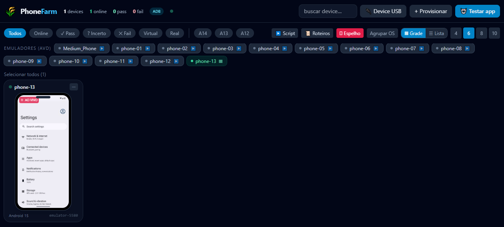
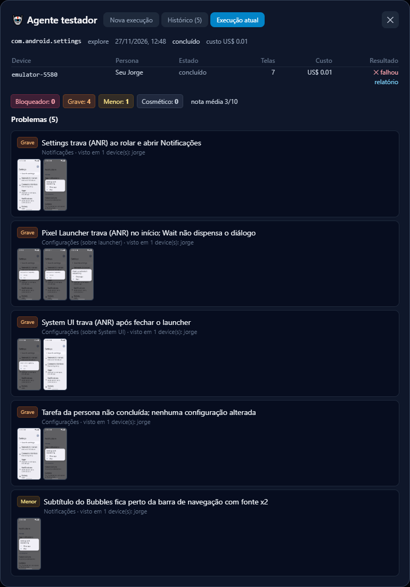

<h1 align="center">🌾 Phone Farm</h1>

<p align="center">
  <b>A local Android phone farm — with an AI agent that tests your app before you ship it.</b>
</p>

<p align="center">
  <a href="./README.md">Português</a> · <b>English</b>
</p>

<p align="center">
  
</p>

**Phone Farm** turns your PC into an **Android device farm** for QA:

- 📱 **Emulators from the UI** — create, boot and stop AVDs in one click; physical devices over USB too.
- 🪞 **Live mirror** of every screen in a grid, with **full control** (tap, drag, keys, text, URL, rotation).
- 📦 **Bulk APK install**, screen recording and **automation scripts** across many devices at once.
- 🤖 **AI test agent** — Claude uses your app as **real people** would (a 74-year-old at 200% font size,
  someone who types invalid data on purpose, dark-mode users…) and returns **issues with screenshots**,
  sorted by severity. Each device card gets ✓ pass / ? uncertain / ✕ fail.
- 🔒 **Fully local** — no device cloud, no subscription; each agent can only touch its own device.

<p align="center">
  
</p>

## Quick start

**Windows:** grab the installer from [Releases](https://github.com/Wellington-HMV/phone-farm/releases/latest)
(you need [Android Studio](https://developer.android.com/studio) for emulators).

**Any OS (from source):**

```bash
git clone https://github.com/Wellington-HMV/phone-farm.git
cd phone-farm && npm install && (cd server && npm install)
npm start            # http://localhost:4000 — without the Android SDK it opens in demo (mock) mode
```

For the AI test agent: [Claude Code](https://docs.claude.com/en/docs/claude-code) installed and logged in,
and your app installed on the devices. Click **🤖 Testar app**, pick the package, a mission
(explore · test a feature · reproduce a bug · UX improvements) and personas.

The UI is in Portuguese (pt-BR); contributions for i18n are welcome.

## How the AI agent works

One headless `claude -p` per device. The agent only gets two tools, both pinned to its own device:
`screen` (screenshot + UI elements + accessibility check + logcat crashes) and `act`
(tap / swipe / type / back / relaunch). No raw `adb`, no network tools, no MCP servers, none of
your personal Claude Code settings. Font scale and theme are applied per persona and restored
afterwards. If the agent runs out of turns before writing its report, the same session is resumed
just to write it.

Adapted from [mobile-agent-testers](https://github.com/pierridotite/mobile-agent-testers) (MIT),
which runs the same idea on GitHub Actions — here it runs on your machine.

## Stack

React + Vite + Tailwind · Node + Express + WebSocket · MJPEG streaming (`sharp`) · Electron desktop app.

## License

MIT. Built for QA and automation of **your own** apps — not for fraud, multi-accounting or
bypassing third-party Terms of Service.
